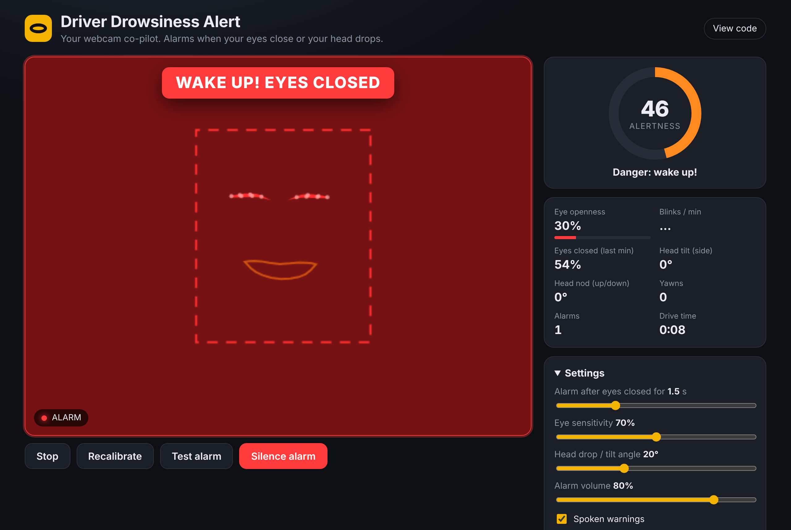

# Driver Drowsiness Alert

**Live demo:** https://knarf24.github.io/driver-drowsiness-alert/

A webcam co-pilot that sounds an alarm when your eyes close or your head drops. It runs entirely in the browser: no install, no server, and no video ever leaves your device.



## The problem
Tired drivers cause crashes, and the warning signs (long blinks, a nodding head, yawning) show up before it is too late. This app watches for those signs and wakes the driver with a siren and a spoken warning.

## Features
- **Face tracking** with 478 landmarks from the webcam (MediaPipe Face Landmarker).
- **Eye closure and blink detection** using the eye aspect ratio, calibrated to your own eyes in the first 3 seconds.
- **Head drop and tilt detection** from the 3D head pose.
- **Yawn detection** from how wide the mouth opens, and a warning when you look away from the road.
- **Alarm**: siren (Web Audio), spoken warning (browser text-to-speech) and a flashing red screen.
- **Alertness score**, blinks per minute, and PERCLOS (share of the last minute with eyes closed).
- Adjustable thresholds, volume and voice; works on phones and laptops.

## Built from four GeeksforGeeks Python projects
| GeeksforGeeks project | Used here as |
|---|---|
| [Face Detection with Webcam](https://www.geeksforgeeks.org/python/face-detection-using-python-and-opencv-with-webcam/) | Live face tracking in the browser |
| [Eye Blink Detection](https://www.geeksforgeeks.org/machine-learning/python-eye-blink-detection-project/) | Eye aspect ratio for blinks and long closures |
| [Determine Face Tilt](https://www.geeksforgeeks.org/python/determine-the-face-tilt-using-opencv-python/) | Head roll and nod from the face pose |
| [Convert Text to Speech](https://www.geeksforgeeks.org/python/convert-text-speech-python/) | Spoken warnings with the Web Speech API |

The originals are desktop Python (OpenCV, dlib, pyttsx3). This version is rewritten in JavaScript so anyone can try it from a link.

## Run locally
Any static server works, for example:
```
python3 -m http.server 8000
```
Then open http://localhost:8000. Browsers only allow the camera on `https://` or `localhost`.

## Files
- `index.html`, `styles.css`, `app.js`: the app.
- `vendor/mediapipe/`: MediaPipe Tasks Vision 0.10.21 (Apache-2.0), bundled so the app needs no CDN.
- `models/face_landmarker.task`: Google's Face Landmarker model (Apache-2.0).

## Disclaimer
A demo and a safety aid, not a substitute for rest. If you feel tired, pull over.
